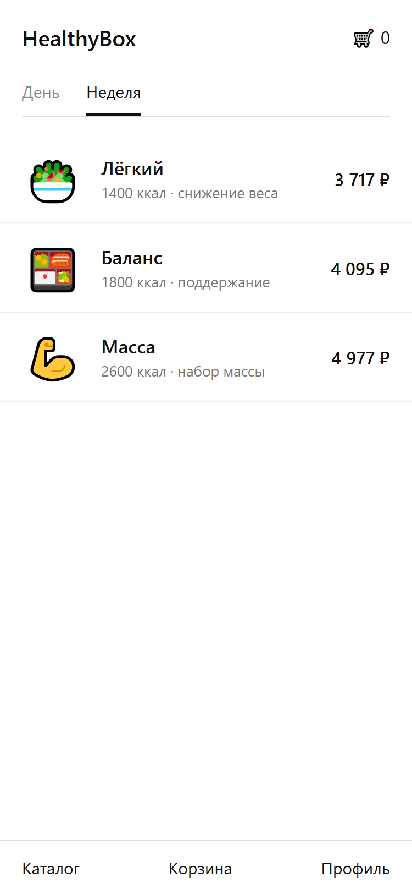
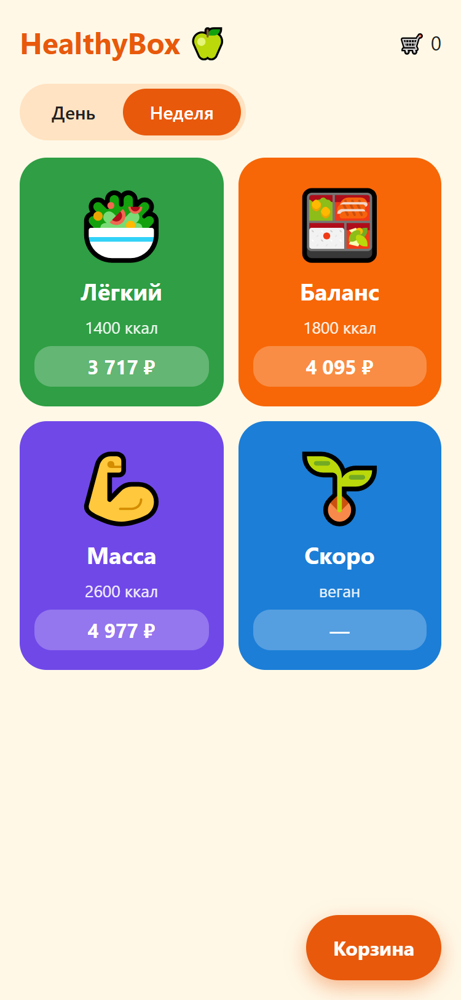
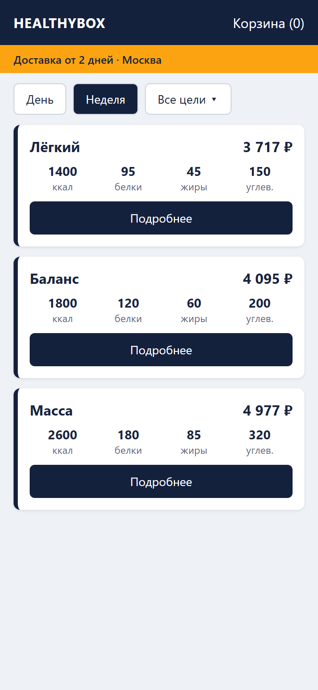

% ДЗ 3. Генерация UI-концепций и технического задания
% Проект: HealthyBox (мобильное приложение для заказа здорового питания, MVP)


# 1. Описание проекта (project_description.md)

## 1. Проблема

Люди 25–45 лет хотят питаться сбалансированно, но не успевают готовить и считать КБЖУ. Существующие сервисы либо дороги, либо требуют сложной настройки рациона, либо не показывают состав и цену до оформления заказа.

## 2. Целевая аудитория

- Возраст 25–45 лет, городские жители, работают полный день.
- Бюджет ограничен: важна понятная цена за день и за неделю.
- Приоритеты: скорость выбора, прозрачный состав и КБЖУ, предсказуемая доставка.

## 3. Ценность

Готовый набор блюд на день или неделю выбирается за несколько экранов: тип питания, состав, дата доставки, оплата.

## 4. Ключевые функции MVP

1. Каталог типов питания (рационов) с калорийностью и ценой.
2. Детальный просмотр набора: меню по дням, КБЖУ, состав, аллергены.
3. Корзина и выбор даты первой доставки.

Оплата и оформление доставки входят в сквозной путь (см. `user_journey.md`), но карта историй в этом ДЗ покрывает этапы 1–4.

## 5. Вне MVP

Сложная кастомизация рациона, собственная логистика, AI-рекомендации.

## 6. Связанные документы

| Файл | Содержание |
|---|---|
| `user_journey.md` | Пользовательский путь (Happy Path) |
| `user_stories.md` | Карта историй с критериями приёмки (Gherkin) |
| `technical_specification.md` | Требования для AI-инженера |
| `error_handling.md` | Негативные сценарии и UX-решения |
| `ui_concepts/ui_description.md` | Три UI-концепции и обоснование выбора |


# 2. UI-концепции (ui_concepts/ui_description.md)

## Как созданы концепции

Text-to-UI сервисы (v0.dev, Galileo AI) не использовались: их запуск требует аккаунта пользователя. Три концепции созданы Claude Code как статичные HTML-макеты по текстовому описанию стиля и скриншотированы в Edge на экране 375×812 px. Это допустимая замена по формулировке «или аналогичные», но не результат специализированного Text-to-UI инструмента. Исходные файлы: `concept_a_minimal.html`, `concept_b_bright.html`, `concept_c_corporate.html`.

Экран во всех концепциях один: каталог типов питания (этап 3 пути пользователя) с переключателем «День/Неделя», тремя рационами, калорийностью и ценой.

## Концепция A. Минималистичная (список)



- Стиль: белый фон, тонкие разделители, один акцент — чёрный цвет, много воздуха.
- Компоновка: вертикальный список строк «иконка — название и цель — цена», нижняя панель навигации.
- Преимущества: максимально быстро сканируется, много рационов помещается на экране, дешёвая реализация.
- Недостатки: слабый аппетитный эффект, нет визуального различия рационов, мало эмоций.

## Концепция B. Яркая (плитки)



- Стиль: тёплый фон, насыщенные цвета для каждого рациона, крупные эмодзи-иллюстрации, скруглённые формы.
- Компоновка: сетка из 2 колонок, плавающая кнопка корзины.
- Преимущества: запоминается, цвет помогает различать рационы, высокий эмоциональный отклик.
- Недостатки: при росте числа рационов сетка перегружается, белый текст на ярких плитках нужно проверять на контраст, сложнее сохранять единый стиль с реальными фото блюд.

## Концепция C. Корпоративная (карточки с КБЖУ)



- Стиль: тёмно-синяя шапка, жёлтая информационная полоса, строгая типографика.
- Компоновка: карточки с таблицей КБЖУ, фильтр по цели, плашка условий доставки.
- Преимущества: сразу видно состав, вызывает доверие, удобно сравнивать рационы по цифрам.
- Недостатки: информационно плотно для маленького экрана, выглядит как сервис для корпоративных заказов, а не для личного питания.

## Сравнение

| Критерий | A. Минимализм | B. Яркая | C. Корпоративная |
|---|---|---|---|
| Скорость выбора | Высокая | Средняя | Средняя |
| Эмоциональный отклик | Низкий | Высокий | Низкий |
| Прозрачность состава (КБЖУ) | Низкая | Низкая | Высокая |
| Стоимость реализации | Низкая | Средняя | Средняя |
| Масштабируемость каталога | Высокая | Низкая | Средняя |

## Выбор

Выбрана концепция A (минималистичная) с одним заимствованием из C: КБЖУ показывается на экране детального просмотра набора, а не в каталоге.

Обоснование:
1. Для ЦА 25–45 лет с ограниченным бюджетом главное — быстро найти подходящий рацион и увидеть цену. Список сканируется быстрее плиток.
2. MVP создаётся за 3 месяца: концепция A проще всего реализуется и поддерживается.
3. Каталог будет расти (веган и другие рационы); список масштабируется лучше сетки из ярких плиток.

Яркость концепции B учтена как направление для будущих версий (цветовое различение рационов), когда появятся реальные фотографии блюд.

В реализации ДЗ 4 использованы карточки и зелёный акцент вместо строгого чёрно-белого списка: это отклонение от макета, сделанное ради различимости карточек на разных размерах экрана.


# 3. Пользовательский путь

Контекст: ЦА 25–45 лет, ограниченный бюджет, MVP за 3 месяца. Выбор готового набора на день/неделю, оплата, доставка.

1. **Обнаружение и первая точка входа**
   - **User goal:** Понять, подходит ли сервис по цене и формату, и проверить, что он работает в моём городе.
   - **Actions:** Находит приложение в App Store / Google Play, читает описание, смотрит скриншоты, проверяет рейтинг, устанавливает, открывает, смотрит приветственные слайды, вводит город или адрес.
   - **Touchpoints:** Карточка в сторе, скриншоты с ценами, экран приветствия, экран выбора города.
   - **Emotions:** Любопытство, лёгкий скепсис.
   - **Pain points:** В сторе мало отзывов у нового приложения. Цена не видна до установки. Если город не обслуживается, пользователь узнаёт об этом только после установки.
   - **Improvements:** Реферальные ссылки со скидкой, превью меню без установки (web), сообщение «сообщить, когда придём в ваш город».

2. **Разрешение на уведомления и онбординг**
   - **User goal:** Быстро пройти настройку и получить релевантную подборку.
   - **Actions:** Видит экран с объяснением пользы уведомлений, нажимает «Разрешить», подтверждает системный запрос, отвечает на вопрос о цели питания.
   - **Touchpoints:** Экран-пояснение перед системным запросом, системный диалог, экран выбора цели.
   - **Emotions:** Нейтральность, лёгкая настороженность.
   - **Pain points:** Боязнь спама. Отказ в системном запросе нельзя повторить без перехода в настройки ОС.
   - **Improvements:** Гранулярные настройки уведомлений, повторный мягкий запрос после первого заказа.

3. **Выбор типа питания**
   - **User goal:** Найти подходящий рацион за 1–2 минуты.
   - **Actions:** Листает карточки рационов, переключает «День / Неделя», сравнивает калорийность и цену.
   - **Touchpoints:** Экран каталога, карточка рациона, переключатель срока.
   - **Emotions:** Интерес, затем легкая перегрузка выбором.
   - **Pain points:** Непонятна разница между рационами с близкой калорийностью. Цена за неделю без разбивки по дням кажется высокой.
   - **Improvements:** Сравнение рационов на одном экране, подсказки по калорийности под цель.

4. **Детальный просмотр меню**
   - **User goal:** Убедиться, что блюда подходят по вкусу, составу и аллергенам.
   - **Actions:** Открывает набор, смотрит меню по дням, открывает блюдо, читает КБЖУ и аллергены, нажимает «Добавить в корзину», выбирает дату первой доставки, проверяет корзину.
   - **Touchpoints:** Экран набора, экран блюда, календарь, корзина.
   - **Emotions:** Доверие при полной информации, тревога при её нехватке.
   - **Pain points:** Фото не совпадают с реальными блюдами. Минимальный срок до первой доставки (2 дня) ограничивает выбор даты.
   - **Improvements:** Фото реальных блюд от кухни, отзывы по блюдам, замена одного блюда в наборе.

5. **Оформление доставки**
   - **User goal:** Указать адрес и удобный интервал без лишних полей.
   - **Actions:** Нажимает «Оформить», вводит адрес и телефон, выбирает интервал доставки.
   - **Touchpoints:** Экран адреса с подсказками, выбор интервала, итог заказа.
   - **Emotions:** Лёгкое нетерпение.
   - **Pain points:** Ручной ввод адреса на телефоне. Нет гарантии точного времени курьера.
   - **Improvements:** Определение адреса по геолокации, сохранённые адреса, push за час до прибытия.

6. **Оплата**
   - **User goal:** Оплатить быстро и безопасно.
   - **Actions:** Проверяет сумму, выбирает оплату картой или Apple Pay / Google Pay, подтверждает.
   - **Touchpoints:** Экран оплаты, платёжная форма провайдера, 3-D Secure.
   - **Emotions:** Напряжённость.
   - **Pain points:** Переход на страницу банка выглядит подозрительно. Неясно, когда возвращаются деньги при отмене.
   - **Improvements:** Сохранение карты, оплата по СБП, промокоды.

7. **Подтверждение заказа**
   - **User goal:** Убедиться, что заказ принят.
   - **Actions:** Видит экран успеха с номером и датой первой доставки, получает push/email.
   - **Touchpoints:** Экран «Заказ оформлен», push-уведомление, email-чек.
   - **Emotions:** Облегчение.
   - **Pain points:** Нет возможности изменить заказ после подтверждения.
   - **Improvements:** Окно для правок до начала готовки, добавление в календарь.

8. **Ожидание и получение доставки**
   - **User goal:** Получить еду в выбранный интервал.
   - **Actions:** Получает уведомление о начале доставки, встречает курьера, получает набор.
   - **Touchpoints:** Push-уведомление, звонок курьера, упаковка.
   - **Emotions:** Ожидание, затем удовлетворение или раздражение при опоздании.
   - **Pain points:** Сдвиг интервала доставки. Сторонний курьер может не знать особенностей хранения.
   - **Improvements:** Трекинг курьера на карте, инструкция по хранению в упаковке.

9. **Обратная связь и повторный заказ**
   - **User goal:** Оценить еду и заказать снова без повторного ввода данных.
   - **Actions:** Получает запрос на оценку, ставит оценку, нажимает «Повторить заказ».
   - **Touchpoints:** Push с запросом оценки, экран оценки, кнопка «Повторить».
   - **Emotions:** Удовлетворённость.
   - **Pain points:** Слишком частые запросы на оценку раздражают. Рацион повторяется, и это быстро надоедает.
   - **Improvements:** Подписка с автопродлением, ротация меню, программа лояльности.

## Названия этапов

- Обнаружение и первая точка входа
- Разрешение на уведомления и онбординг
- Выбор типа питания
- Детальный просмотр меню
- Оформление доставки
- Оплата
- Подтверждение заказа
- Ожидание и получение доставки
- Обратная связь и повторный заказ


# 4. Карта пользовательских историй (user_stories.md)

Роль во всех историях: «пользователь» (новый или вернувшийся клиент 25–45 лет). Этапы 1–4 пути: обнаружение и вход, уведомления и онбординг, выбор типа питания, детальный просмотр меню.

Приоритеты: **Must** — без этого MVP не работает, **Should** — важно, но MVP запускается без этого.

1. **Просмотр приветственных экранов** — *Must*
   Как пользователь, я хочу увидеть при первом запуске краткое описание сервиса и кнопку «Начать», чтобы понять, что приложение даёт, и перейти к использованию без регистрации.

   Критерии приемки:
   ```gherkin
   Сценарий: Первый запуск приложения
     Дано пользователь впервые открыл установленное приложение
     Когда загрузился стартовый экран
     Тогда отображаются 3 слайда с описанием (готовые наборы, доставка, цена от) и кнопка «Начать»
     И индикатор показывает номер текущего слайда

   Сценарий: Переход дальше
     Дано пользователь находится на стартовом экране
     Когда пользователь нажал «Начать»
     Тогда открывается экран выбора города
     И регистрация или вход не требуются
   ```

2. **Выбор города доставки** — *Must*
   Как пользователь, я хочу указать город доставки до просмотра меню, чтобы убедиться, что сервис работает в моём городе.

   Критерии приемки:
   ```gherkin
   Сценарий: Выбор обслуживаемого города
     Дано пользователь находится на экране выбора города
     И отображается список обслуживаемых городов
     Когда пользователь выбрал город из списка
     Тогда выбранный город сохраняется на устройстве
     И открывается следующий этап онбординга

   Сценарий: Повторный запуск
     Дано пользователь ранее выбрал город
     Когда пользователь снова открывает приложение
     Тогда экран выбора города не показывается
   ```

3. **Разрешение на уведомления** — *Must*
   Как пользователь, я хочу узнать, зачем приложению нужны уведомления, до системного запроса, чтобы осознанно решить, разрешать ли их.

   Критерии приемки:
   ```gherkin
   Сценарий: Пояснение перед системным запросом
     Дано пользователь завершил выбор города
     Когда открылся экран уведомлений
     Тогда отображается текст о пользе уведомлений (статус заказа, доставка) и кнопки «Разрешить» и «Не сейчас»

   Сценарий: Пользователь разрешает уведомления
     Дано пользователь находится на экране уведомлений
     Когда пользователь нажал «Разрешить»
     Тогда показывается системный запрос разрешения уведомлений
     И после выбора пользователя открывается следующий шаг онбординга

   Сценарий: Пользователь пропускает запрос
     Дано пользователь находится на экране уведомлений
     Когда пользователь нажал «Не сейчас»
     Тогда системный запрос не показывается
     И открывается следующий шаг онбординга
   ```

4. **Выбор цели питания в онбординге** — *Should*
   Как пользователь, я хочу выбрать цель питания (похудение, поддержание веса, набор массы), чтобы в каталоге первыми видеть подходящие рационы.

   Критерии приемки:
   ```gherkin
   Сценарий: Выбор цели
     Дано пользователь находится на экране выбора цели
     И отображаются 3 варианта цели и кнопка «Пропустить»
     Когда пользователь выбрал цель и нажал «Продолжить»
     Тогда цель сохраняется на устройстве
     И открывается каталог типов питания

   Сценарий: Каталог учитывает цель
     Дано пользователь выбрал цель «Похудение»
     Когда открылся каталог
     Тогда рационы с этой целью отображаются в начале списка

   Сценарий: Пропуск
     Дано пользователь находится на экране выбора цели
     Когда пользователь нажал «Пропустить»
     Тогда открывается каталог с порядком рационов по умолчанию
   ```

5. **Просмотр каталога типов питания** — *Must*
   Как пользователь, я хочу видеть список рационов с фото, калорийностью в день и ценой, чтобы быстро выбрать подходящий.

   Критерии приемки:
   ```gherkin
   Сценарий: Отображение каталога
     Дано пользователь открыл каталог
     Когда данные загружены
     Тогда отображается список карточек рационов
     И каждая карточка содержит фото, название, калорийность в день и цену «от»

   Сценарий: Переход к рациону
     Дано пользователь находится в каталоге
     Когда пользователь нажал на карточку рациона
     Тогда открывается экран набора выбранного рациона
   ```

6. **Переключение срока набора: день или неделя** — *Must*
   Как пользователь, я хочу переключать срок набора между «День» и «Неделя», чтобы увидеть цену за нужный срок.

   Критерии приемки:
   ```gherkin
   Сценарий: Переключение срока
     Дано пользователь находится в каталоге
     И по умолчанию выбран срок «Неделя»
     Когда пользователь нажал «День»
     Тогда цены на всех карточках пересчитываются на один день
     И выбранный срок подсвечен

   Сценарий: Срок сохраняется
     Дано пользователь выбрал срок «День» в каталоге
     Когда пользователь открыл экран набора
     Тогда на экране набора выбран срок «День»
   ```

7. **Просмотр детального описания набора** — *Must*
   Как пользователь, я хочу видеть состав набора по дням с КБЖУ и ценой, чтобы оценить, подходит ли он мне.

   Критерии приемки:
   ```gherkin
   Сценарий: Экран набора
     Дано пользователь открыл экран набора
     Когда данные загружены
     Тогда отображаются название, описание, цена за выбранный срок и КБЖУ в день
     И список дней с приёмами пищи и названиями блюд

   Сценарий: Выбор дня
     Дано пользователь находится на экране набора
     Когда пользователь выбрал день в списке
     Тогда отображаются блюда этого дня с фото и граммовкой
   ```

8. **Просмотр карточки блюда** — *Must*
   Как пользователь, я хочу открыть блюдо и увидеть состав, КБЖУ и аллергены, чтобы убедиться, что оно мне подходит.

   Критерии приемки:
   ```gherkin
   Сценарий: Карточка блюда
     Дано пользователь находится на экране набора
     Когда пользователь нажал на блюдо
     Тогда открывается карточка с фото, названием, граммовкой, составом, КБЖУ и списком аллергенов

   Сценарий: Возврат
     Дано пользователь находится в карточке блюда
     Когда пользователь нажал «Назад»
     Тогда открывается экран набора с сохранённым выбранным днём
   ```

9. **Добавление набора в корзину с выбором даты первой доставки** — *Must*
   Как пользователь, я хочу при добавлении набора в корзину выбрать дату первой доставки, чтобы получить заказ в удобный день.

   Критерии приемки:
   ```gherkin
   Сценарий: Открытие календаря
     Дано пользователь находится на экране набора
     Когда пользователь нажал «Добавить в корзину»
     Тогда открывается модальное окно с календарём
     И даты ранее чем через 2 дня от текущей недоступны для выбора

   Сценарий: Добавление в корзину
     Дано открыт календарь
     Когда пользователь выбрал доступную дату и нажал «Подтвердить»
     Тогда набор добавляется в корзину с выбранной датой и сроком
     И на иконке корзины отображается обновлённое количество позиций
   ```

10. **Просмотр корзины и изменение количества наборов** — *Must*
    Как пользователь, я хочу просматривать состав корзины и изменять количество наборов, чтобы скорректировать свой заказ.

    Критерии приемки:
    ```gherkin
    Сценарий: Просмотр корзины
      Дано в корзине есть хотя бы одна позиция
      Когда пользователь нажал на иконку корзины
      Тогда открывается экран корзины
      И для каждой позиции отображаются фото, название, срок, дата первой доставки, цена за единицу, количество и сумма по позиции
      И под списком отображается итоговая сумма заказа

    Сценарий: Изменение количества
      Дано пользователь находится на экране корзины
      Когда пользователь нажал «+» или «-» у позиции
      Тогда количество изменяется на 1
      И сумма по позиции и итоговая сумма пересчитываются автоматически

    Сценарий: Удаление при нуле
      Дано количество позиции равно 1
      Когда пользователь нажал «-»
      Тогда позиция удаляется из корзины
      И итоговая сумма пересчитывается
    ```

## Названия историй и этапы пути

- Просмотр приветственных экранов — этап 1. Обнаружение и первая точка входа
- Выбор города доставки — этап 1. Обнаружение и первая точка входа
- Разрешение на уведомления — этап 2. Разрешение на уведомления и онбординг
- Выбор цели питания в онбординге — этап 2. Разрешение на уведомления и онбординг
- Просмотр каталога типов питания — этап 3. Выбор типа питания
- Переключение срока набора: день или неделя — этап 3. Выбор типа питания
- Просмотр детального описания набора — этап 4. Детальный просмотр меню
- Просмотр карточки блюда — этап 4. Детальный просмотр меню
- Добавление набора в корзину с выбором даты первой доставки — этап 4. Детальный просмотр меню
- Просмотр корзины и изменение количества наборов — этап 4. Детальный просмотр меню


# 5. Техническое задание (technical_specification.md)

## 1. Функциональные требования

### 1.1. Запуск и выбор города (истории 1–2)

1. Система должна отображать при первом запуске приложения стартовый экран с 3 слайдами и кнопкой «Начать», чтобы пользователь понял назначение сервиса.
2. Система должна отображать на стартовом экране индикатор номера текущего слайда при смене слайда, чтобы пользователь видел прогресс.
3. Система должна открывать экран выбора города без требования регистрации или входа при нажатии кнопки «Начать», чтобы пользователь продолжил без барьеров.
4. Система должна отображать на экране выбора города список обслуживаемых городов при его открытии, чтобы пользователь мог выбрать только доступный город.
5. Система должна сохранять выбранный город на устройстве и открывать следующий шаг онбординга при выборе города из списка, чтобы данные не запрашивались повторно.
6. Система должна пропускать экран выбора города при повторном запуске, если город уже сохранён, чтобы пользователь не повторял действие.

### 1.2. Уведомления и цель питания (истории 3–4)

7. Система должна отображать экран с описанием пользы уведомлений и кнопками «Разрешить» и «Не сейчас» при завершении выбора города, чтобы пользователь решил осознанно.
8. Система должна показывать системный запрос разрешения уведомлений при нажатии кнопки «Разрешить», чтобы получить согласие пользователя.
9. Система должна открывать следующий шаг онбординга после ответа на системный запрос, чтобы онбординг продолжился при любом решении пользователя.
10. Система должна открывать следующий шаг онбординга без показа системного запроса при нажатии кнопки «Не сейчас», чтобы пользователь мог отложить решение.
11. Система должна отображать экран выбора цели с 3 вариантами (похудение, поддержание веса, набор массы) и кнопкой «Пропустить» при открытии шага, чтобы пользователь мог указать цель питания.
12. Система должна сохранять выбранную цель на устройстве и открывать каталог при нажатии кнопки «Продолжить», чтобы цель использовалась при отображении каталога.
13. Система должна размещать в начале списка каталога рационы, соответствующие сохранённой цели, при открытии каталога, чтобы пользователь сначала видел подходящие рационы.
14. Система должна открывать каталог с порядком рационов по умолчанию при нажатии кнопки «Пропустить», чтобы пользователь мог пропустить шаг.

### 1.3. Каталог типов питания (истории 5–6)

15. Система должна отображать в каталоге список карточек рационов при завершении загрузки данных, чтобы пользователь увидел доступные рационы.
16. Система должна отображать на каждой карточке рациона фото, название, калорийность в день и цену «от», чтобы пользователь мог сравнить рационы.
17. Система должна открывать экран набора выбранного рациона при нажатии на карточку рациона, чтобы пользователь увидел детали.
18. Система должна использовать по умолчанию срок «Неделя» при первом открытии каталога, чтобы цены отображались для недельного набора.
19. Система должна пересчитывать цены на всех карточках каталога на выбранный срок при переключении между «День» и «Неделя», чтобы пользователь видел цену нужного срока.
20. Система должна выделять выбранный срок визуально при переключении между «День» и «Неделя», чтобы пользователь видел текущий выбор.
21. Система должна применять выбранный в каталоге срок на экране набора при открытии экрана набора, чтобы срок не нужно было выбирать повторно.

### 1.4. Детальный просмотр меню (истории 7–8)

22. Система должна отображать на экране набора название, описание, цену за выбранный срок и КБЖУ в день при завершении загрузки данных, чтобы пользователь оценил набор.
23. Система должна отображать на экране набора список дней с приёмами пищи и названиями блюд при открытии экрана, чтобы пользователь видел состав набора.
24. Система должна отображать блюда выбранного дня с фото и граммовкой при выборе дня в списке, чтобы пользователь видел детали дня.
25. Система должна открывать карточку блюда с фото, названием, граммовкой, составом, КБЖУ и списком аллергенов при нажатии на блюдо, чтобы пользователь проверил пригодность блюда.
26. Система должна возвращать пользователя на экран набора с сохранённым выбранным днём при нажатии «Назад» в карточке блюда, чтобы не терять контекст просмотра.

### 1.5. Корзина и дата доставки (истории 9–10)

27. Система должна открывать модальное окно с календарём при нажатии кнопки «Добавить в корзину» на экране набора, чтобы пользователь выбрал дату первой доставки.
28. Система должна блокировать выбор дат ранее чем через 2 дня от текущей даты в календаре при его отображении, чтобы соблюсти минимальный срок производства.
29. Система должна добавлять набор в корзину с выбранной датой доставки и сроком при нажатии «Подтвердить» в календаре, чтобы пользователь мог оформить заказ.
30. Система должна обновлять количество позиций на иконке корзины при добавлении набора, чтобы пользователь видел содержимое корзины.
31. Система должна открывать экран корзины при нажатии на иконку корзины, если в корзине есть хотя бы одна позиция, чтобы пользователь проверил заказ.
32. Система должна отображать для каждой позиции корзины фото, название, срок, дату первой доставки, цену за единицу, количество и сумму по позиции при открытии экрана корзины, чтобы пользователь видел состав заказа.
33. Система должна отображать под списком корзины итоговую сумму заказа при открытии экрана корзины, чтобы пользователь видел стоимость.
34. Система должна изменять количество позиции на 1 и автоматически пересчитывать сумму по позиции и итоговую сумму при нажатии «+» или «-», чтобы пользователь корректировал заказ.
35. Система должна удалять позицию из корзины и пересчитывать итоговую сумму при нажатии «-» у позиции с количеством 1, чтобы корзина не содержала позиций с нулевым количеством.

## 2. Нефункциональные требования

### 2.1. Производительность

1. Экран каталога должен отображать список рационов не позднее 2 секунд после открытия при скорости соединения не ниже 4G и при кэшированных данных не позднее 1 секунды.
2. Переключение между «День» и «Неделя» должно обновлять цены в каталоге не позднее 500 мс.
3. Пересчёт сумм в корзине при нажатии «+» или «-» должен выполняться не позднее 300 мс.
4. Холодный запуск приложения до отображения стартового экрана не должен превышать 3 секунд на устройствах не старше 4 лет.

### 2.2. Совместимость

5. Приложение должно работать на iOS 15 и выше и Android 8.0 (API 26) и выше.
6. Интерфейс должен корректно отображаться на экранах шириной от 320 до 430 dp без горизонтальной прокрутки.

### 2.3. Надёжность и данные

7. Выбранные город, цель и срок должны сохраняться на устройстве и восстанавливаться после перезапуска приложения в 100% случаев.
8. Содержимое корзины должно сохраняться после закрытия приложения не менее 7 суток.
9. Доля запусков без аварийного завершения должна быть не ниже 99% на выборке не менее 1000 сессий.

### 2.4. Безопасность и приватность

10. Передача данных между приложением и сервером должна выполняться по HTTPS с TLS не ниже 1.2.
11. Системный запрос разрешения уведомлений должен показываться не более 1 раза за установку приложения без перехода в системные настройки.
12. Просмотр каталога, набора и добавление в корзину должны быть доступны без авторизации.

### 2.5. Удобство использования

13. Размер интерактивных элементов (кнопки, «+», «-», карточки) должен быть не менее 44×44 pt (iOS) и 48×48 dp (Android).
14. Контраст текста к фону должен быть не ниже 4.5:1.
15. Путь от первого запуска до открытия экрана набора не должен превышать 6 нажатий.
16. Изображения блюд должны загружаться в формате WebP размером не более 200 КБ на изображение.


# 6. Обработка ошибок (error_handling.md)

| Функция | Негативный сценарий | UX-решение |
|---|---|---|
| Загрузка каталога / набора | Сетевая ошибка или таймаут 10 с | Экран с текстом «Не удалось загрузить» и кнопкой «Повторить»; закэшированные данные показываются, если есть |
| Каталог | Нет рационов для города | Пустое состояние: «Скоро будем в вашем городе», кнопка «Сменить город» |
| Выбор города | Городов нет в ответе сервера | Сообщение об ошибке и «Повторить»; пользователь не блокируется навсегда |
| Уведомления | Пользователь отклонил системный запрос | Онбординг продолжается; в профиле подсказка «Включить в настройках» |
| Календарь доставки | Нет доступных дат на ближайший месяц | Сообщение «Нет доступных дат», кнопка «Подтвердить» неактивна |
| Календарь доставки | Пользователь выбрал дату, которая стала недоступной | Сообщение «Дата больше недоступна», выбор сбрасывается |
| Карточка блюда | Нет фото | Заглушка с названием блюда |
| Корзина | Пустая корзина | Пустое состояние: «В корзине пусто» и кнопка «К каталогу» |
| Корзина | Цена на сервере изменилась | Сумма пересчитывается, показывается уведомление «Цена обновлена» |
| Корзина | Максимальное количество (например, 10) | Кнопка «+» неактивна, подсказка «Максимум 10» |
| Доступ | Неавторизованный доступ | В MVP этапов 1–4 авторизация не требуется; при 401/403 от сервера показывается экран «Что-то пошло не так» и «Повторить» |

