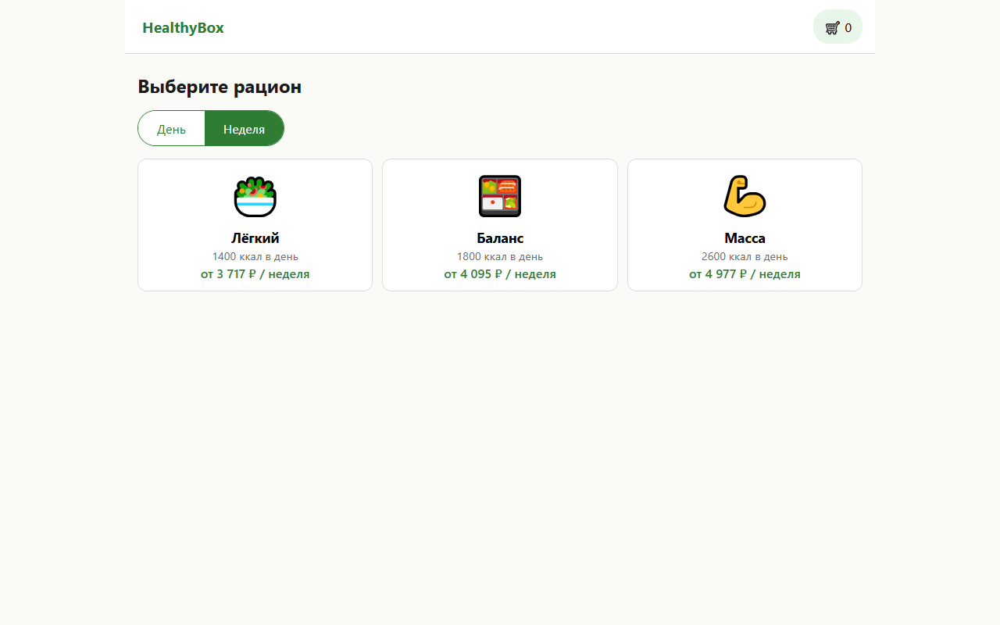
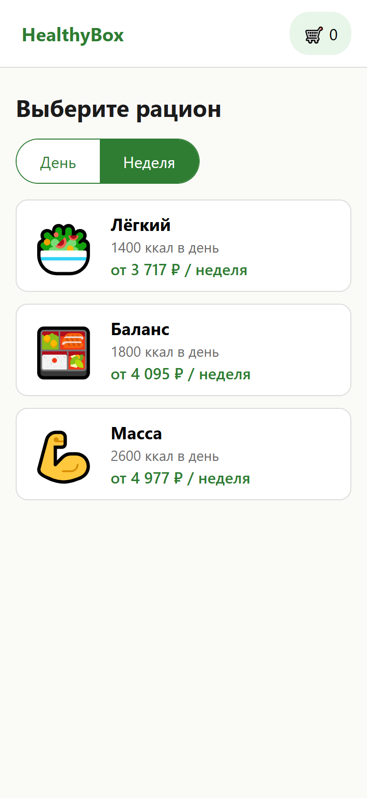
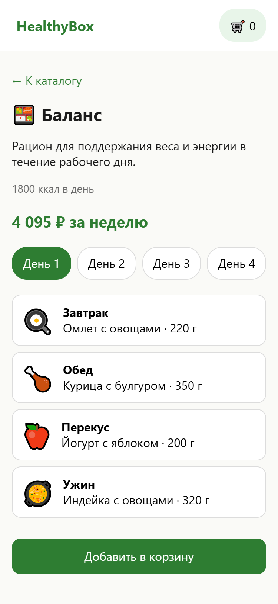
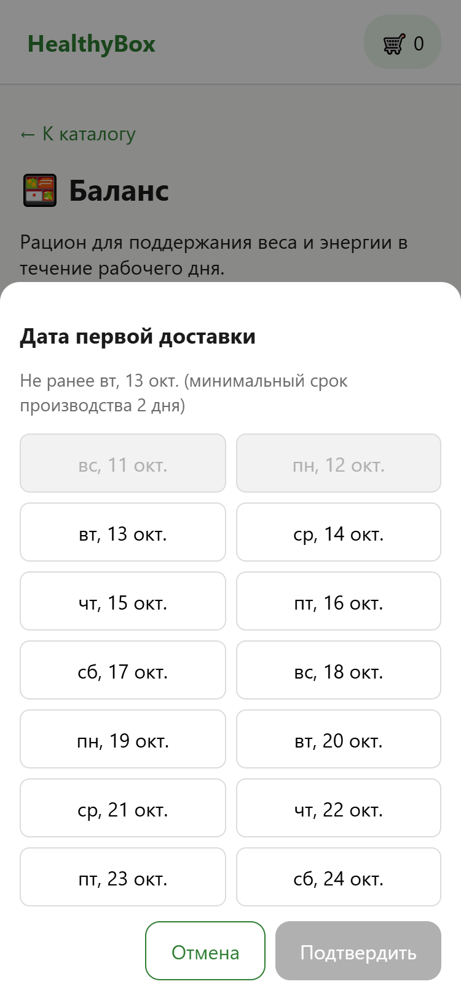
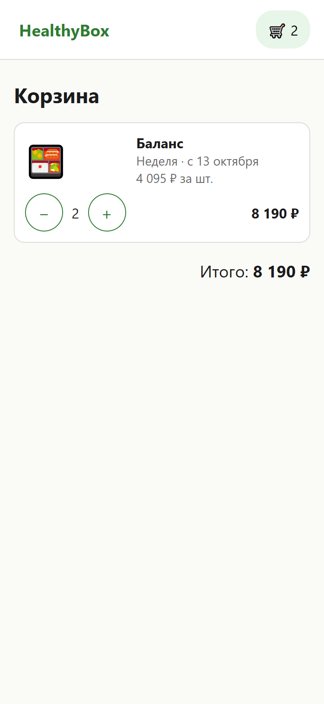
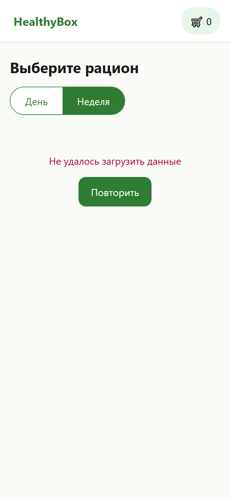

% ДЗ 4. Разработка Frontend-приложения с AI-агентом
% Проект: HealthyBox. Код: папка healthybox-app

# 1. Подготовка технического задания

Использовано ТЗ из ДЗ 3 (этапы 1–4 пользовательского пути). Реализованы три основные функции:

1. Каталог типов питания с переключателем «День / Неделя» и пересчётом цен.
2. Детальный просмотр набора: меню по дням, карточка блюда с КБЖУ, составом и аллергенами.
3. Корзина с календарём выбора даты первой доставки (не ранее чем через 2 дня), изменением количества и итогом.

Онбординг, выбор города и разрешение уведомлений (истории 1–4 из ДЗ 3) в этой версии не реализованы. Это сознательное сокращение: ДЗ требует минимум три функции.

## Технологический стек

| Элемент | Выбор | Почему |
|---|---|---|
| Фреймворк | React 18 + TypeScript (strict) | Типизация снижает число ошибок, правила проекта требуют строгих типов |
| Сборка | Vite | Быстрый hot reload, минимальная конфигурация |
| Стили | Обычный CSS с переменными, mobile-first | Один экран и три компонента: UI-библиотека избыточна, размер сборки меньше |
| Тесты | Vitest + Testing Library + jsdom | Одна конфигурация со сборкой |

Отклонение от примеров в ДЗ: Tailwind и Material-UI не использованы, потому что задание допускает «другую» библиотеку, а для MVP достаточно обычного CSS.

# 2. Инициализация проекта

Агент создал конфигурацию вручную по спецификации: `package.json`, `vite.config.ts`, `tsconfig.json`, `index.html`. Установка зависимостей: `npm install`. Файл правил `CLAUDE.md` из ДЗ 2 помещён в корень проекта.

Запуск окружения разработки:

```bash
npm install
npm run dev     # http://localhost:5173, hot reload
```

# 3. Реализация базовой структуры

```
src/
  pages/        CatalogPage, SetPage, CartPage
  components/   PeriodToggle, PlanCard, DatePickerModal, StateViews
  lib/          pricing.ts, cart.ts (чистая логика), logger.ts, analytics.ts
  data/         mock.ts, api.ts (mock или Supabase)
  types.ts
```

Роутинг не подключался: три экрана переключаются состоянием в `App.tsx`. Для MVP из трёх экранов этого достаточно, `react-router` добавит зависимость без пользы. При росте числа экранов роутинг нужно будет добавить.

# 4. Разработка компонентов

Все компоненты написаны агентом по промпт-шаблонам из ДЗ 2 (шаблоны 1 и 5). Для каждого реализованы состояния:

| Компонент / экран | loading | error | empty / success |
|---|---|---|---|
| CatalogPage | «Загрузка…» | Сообщение и кнопка «Повторить» | Список карточек / «Скоро будем в вашем городе» |
| DatePickerModal | — | Недоступные даты заблокированы | Кнопка «Подтвердить» активна после выбора даты |
| CartPage | — | — | Список позиций / «В корзине пусто» |

Данные берутся из mock-слоя `data/mock.ts` (3 рациона × 7 дней × 4 приёма пищи, 8 блюд). Для проверки ошибки сети откройте страницу с параметром `?fail=1`.

## Скриншоты













# 5. Тестирование и отладка

## Автоматические тесты

На момент сдачи ДЗ 4 в проекте 18 тестов в 5 файлах (позже добавлены тесты backend-слоя, логгера и аналитики; сейчас их 27 в 8 файлах).

| Файл | Тестов | Что проверяет |
|---|---|---|
| `lib/pricing.test.ts` | 5 | Цена за день и неделю, округление, ошибка при некорректной цене, форматирование |
| `lib/cart.test.ts` | 6 | Правило даты, добавление, объединение одинаковых позиций, ошибка, пересчёт, удаление при 0 |
| `components/DatePickerModal.test.tsx` | 2 | Блокировка первых двух дней, подтверждение выбранной даты |
| `pages/CatalogPage.test.tsx` | 4 | Loading → success, открытие набора, ошибка и успешный повтор, пустое состояние |
| `App.test.tsx` | 1 | Сквозной поток: каталог → набор → календарь → корзина → изменение количества → пустая корзина |

Результат запуска (`npm test`): все тесты пройдены.

```
Test Files  5 passed (5)
     Tests  18 passed (18)
```

Тесты покрывают позитивные сценарии и обработку ошибок (ошибка загрузки, недопустимая дата, пустые данные).

## Отладка с AI

Честная оценка: в ходе ДЗ 4 тесты и проверка типов прошли с первого запуска, поэтому крупных багов исправлять не пришлось. Что было сделано для проверки:

- **Анализ скриншотов мультимодальной моделью.** Агент снял скриншоты экранов через Playwright (Edge) и просмотрел их. Мобильный календарь, каталог и корзина отображаются корректно, заблокированные даты визуально отличаются.
- **Проверка адаптивности программно.** На ширине 320 px горизонтальной прокрутки нет: `scrollWidth <= clientWidth`.
- **Интерпретация ошибок консоли.** Ошибка типов `TS2769` (`'test' does not exist in type 'UserConfigExport'`) появилась позже, при обновлении Vitest до версии 5 (ДЗ 6). Агент определил причину: тип `defineConfig` из `vite` не знает поле `test`. Исправление: импорт `defineConfig` из `vitest/config`.
- **Найденная при проверке неточность в демо-коде.** В демо ДЗ 1 ключ позиции строился через `toISOString()`, что сдвигает дату в часовых поясах восточнее UTC. В основном проекте ключ строится по локальной дате.

# 6. Адаптивная вёрстка

Подход mobile-first: базовые стили для узкого экрана, расширения через `@media`.

| Ширина | Раскладка каталога | Календарь | Строка корзины |
|---|---|---|---|
| до 639 px | 1 колонка | 2 колонки, панель снизу | 2 колонки сетки |
| от 640 px | 2 колонки | 4 колонки, окно по центру | 4 колонки в одну строку |
| от 960 px | 3 колонки, вертикальные карточки | то же | то же |

Проверено на ширинах 375 px (эмуляция телефона), 320 px (минимальная ширина) и 1280 px. Размеры нажимаемых элементов — не менее 44×44 px. Тестирование на реальном телефоне не проводилось.

# 7. Оптимизация и рефакторинг

- Бизнес-логика вынесена из компонентов в чистые функции `lib/` (тестируются без рендера).
- Класс `ApiError` вынесен в отдельный модуль `data/api-error.ts`, чтобы избежать циклической зависимости при ленивой загрузке Supabase-модуля (динамический `import()`).
- Загрузка данных передаётся в `CatalogPage` параметром `load`, что упростило тесты.
- Размер production-сборки: 152 КБ JS (50 КБ gzip) и 4 КБ CSS.

## Использованные промпты

Промпты приведены в ДЗ 2, файл `prompt_methodology.md` (цепочка из 5 шагов).

## Какие приёмы оказались эффективными

1. Файл правил: агент соблюдал запрет на `any`, структуру папок и именование без напоминаний.
2. Передача сегодняшней даты параметром: логика даты стала детерминированной.
3. Тесты вместе с кодом на каждом шаге: ошибки обнаруживались сразу.
4. Проверка скриншотами и программными проверками (ширина 320 px) вместо «на глаз».

# 8. Оформление результатов

## Репозиторий

Структура проекта и инструкции по запуску описаны в `healthybox-app/README.md`. Файл `package.json` содержит все зависимости.

**Репозиторий GitHub и деплой не созданы.** Для этого нужен ваш аккаунт GitHub и хостинг (Vercel или Netlify), а создавать аккаунты и публиковать код от вашего имени агент не может. Приложение запускается локально:

```bash
cd hw4/healthybox-app
npm install
npm run dev
```

Публикация в GitHub:

```bash
cd hw4/healthybox-app
git init
git add .
git commit -m "HealthyBox MVP"
git branch -M main
git remote add origin https://github.com/<ваш-логин>/healthybox.git
git push -u origin main
```

Перед `git add` проверьте, что `.env` не попал в репозиторий (он указан в `.gitignore`).

# 9. Выводы и рекомендации

1. AI-агент хорошо справляется со сборкой типового React-приложения по чёткому ТЗ: структура, компоненты и тесты были получены без исправлений.
2. Чем точнее правила и промпты (ДЗ 2), тем меньше правок. Но отсутствие ошибок на малой задаче не доказывает надёжность на большой.
3. Проверять результат нужно самостоятельно и автоматически: тесты, `tsc`, скриншоты, проверка ширины 320 px.
4. Не проверено: работа на реальных устройствах (iOS Safari, Android Chrome), доступность для скринридеров, поведение на медленной сети. Это стоит сделать до реального запуска.
5. Рекомендации по развитию: роутинг при росте экранов, реальные фотографии блюд, онбординг и выбор города (истории 1–4 ДЗ 3), линтер ESLint и Prettier для автоматической проверки стиля.
